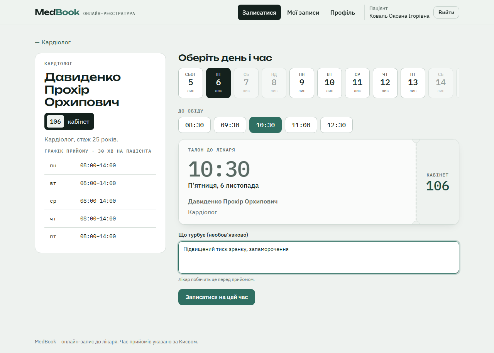
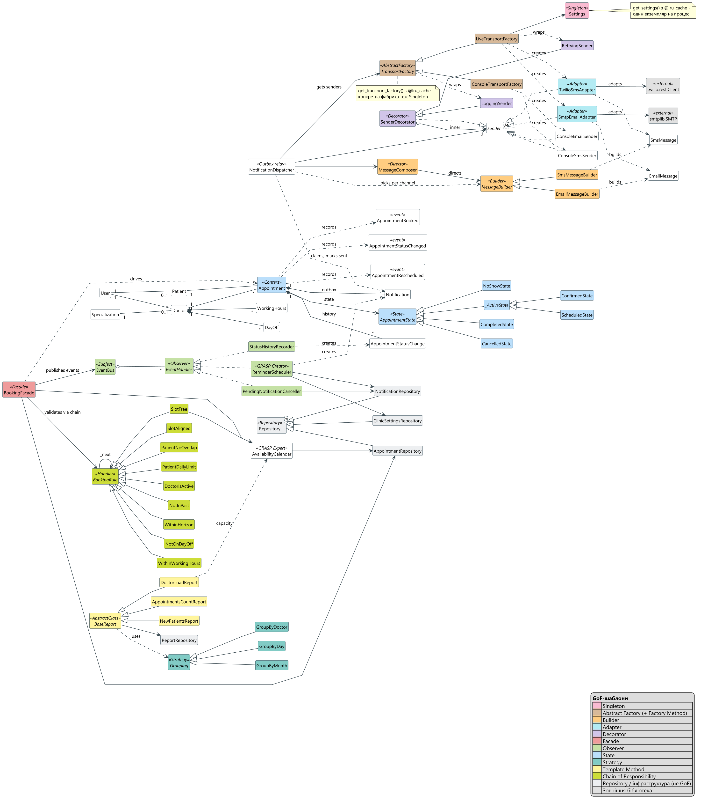
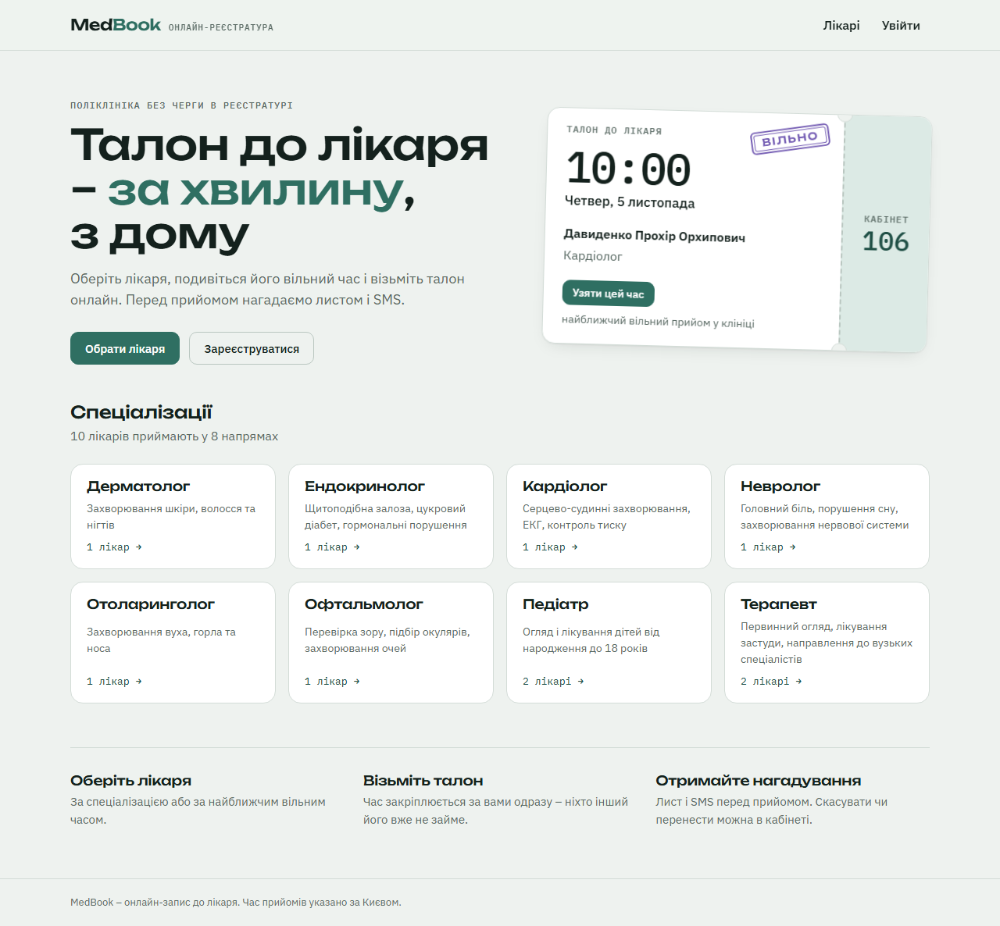
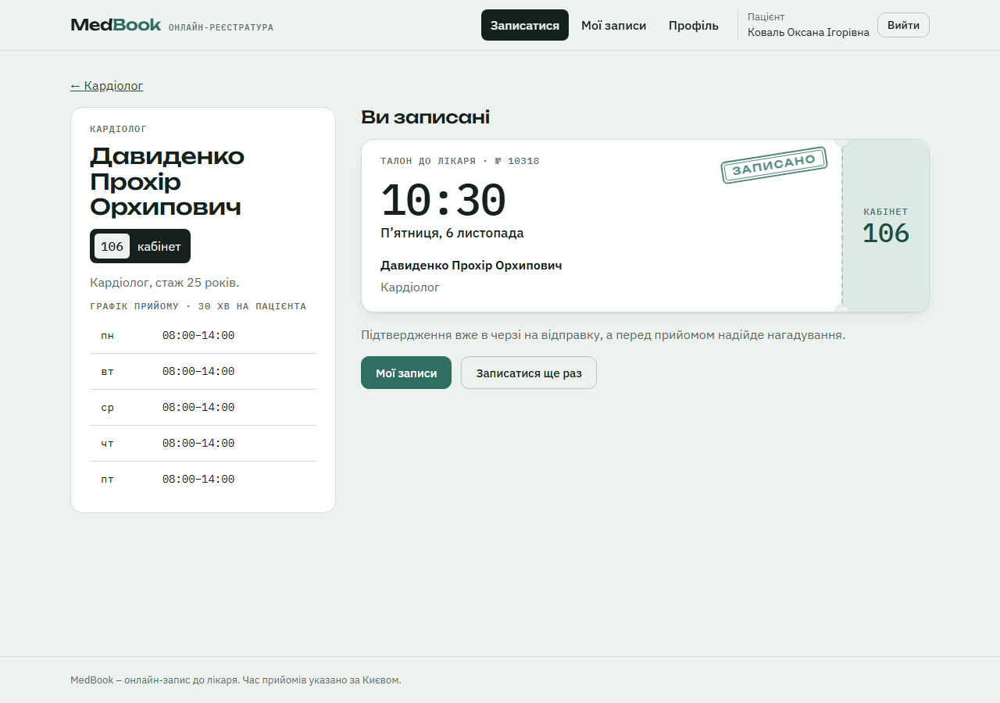
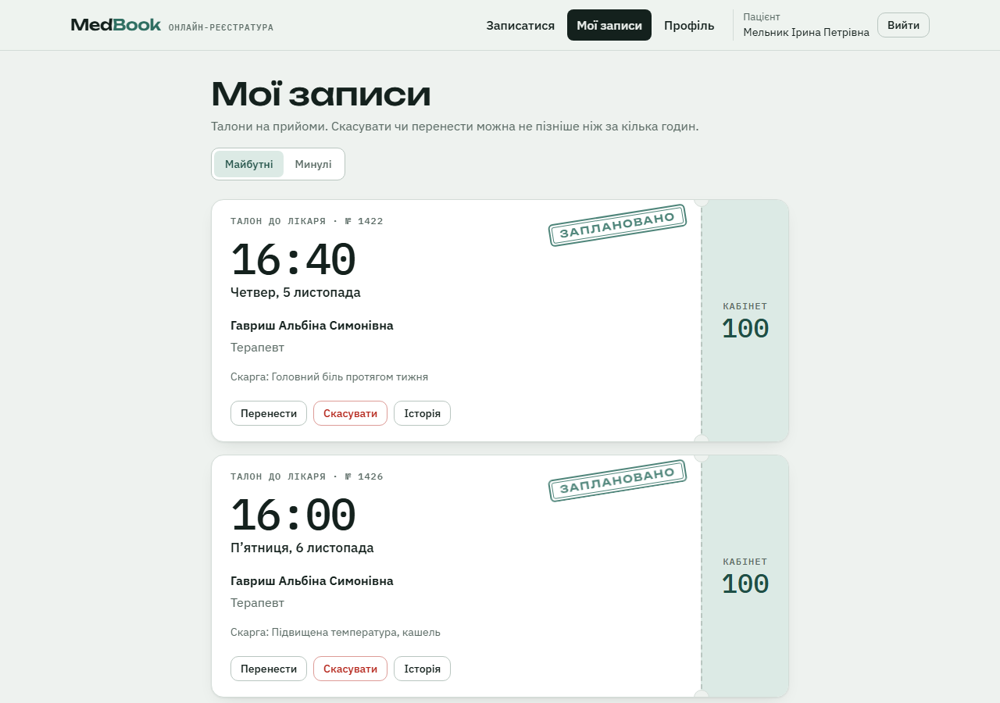
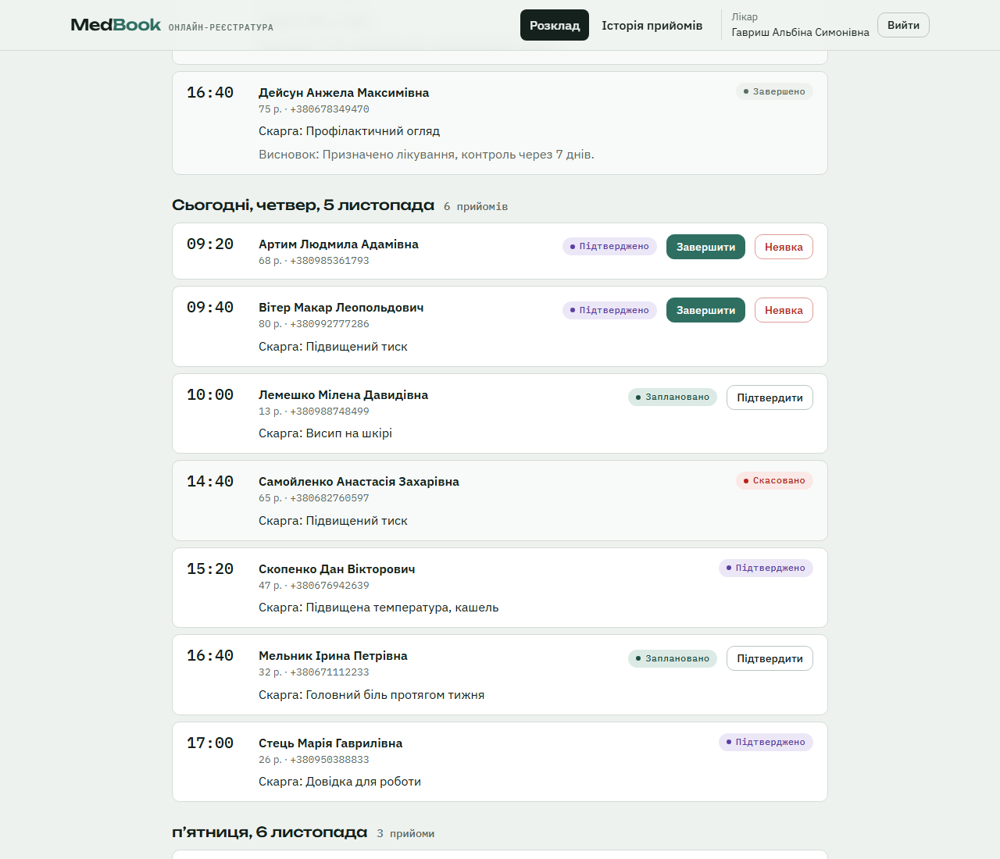
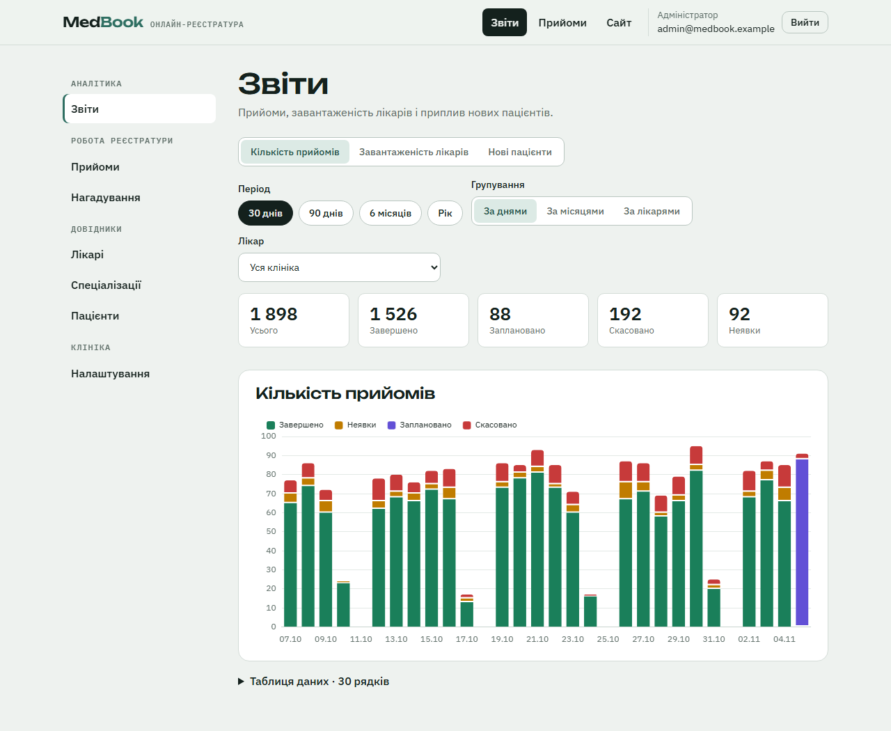
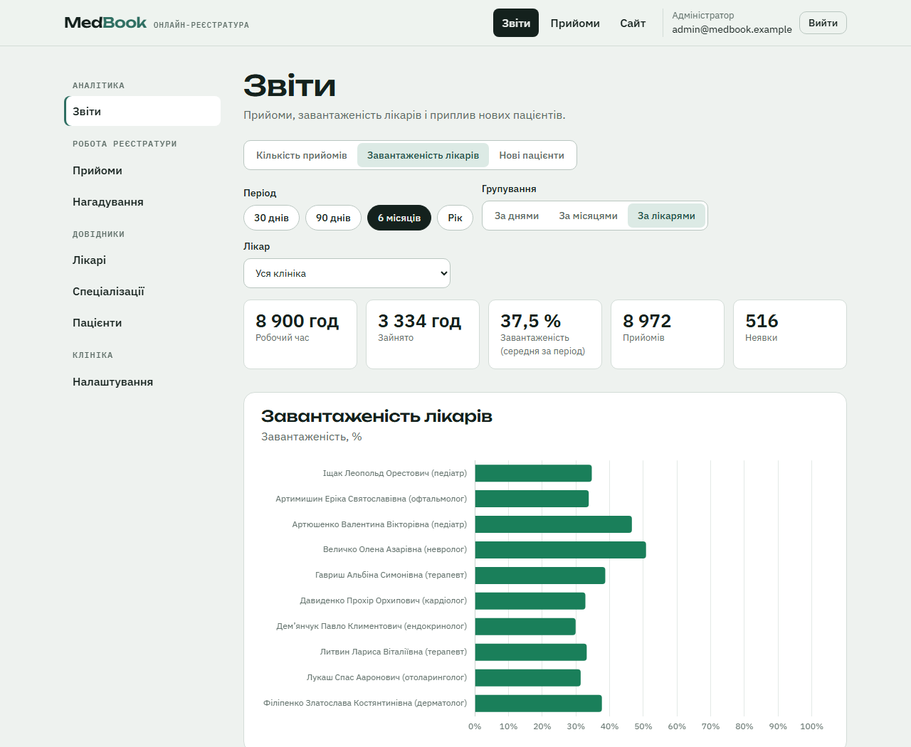
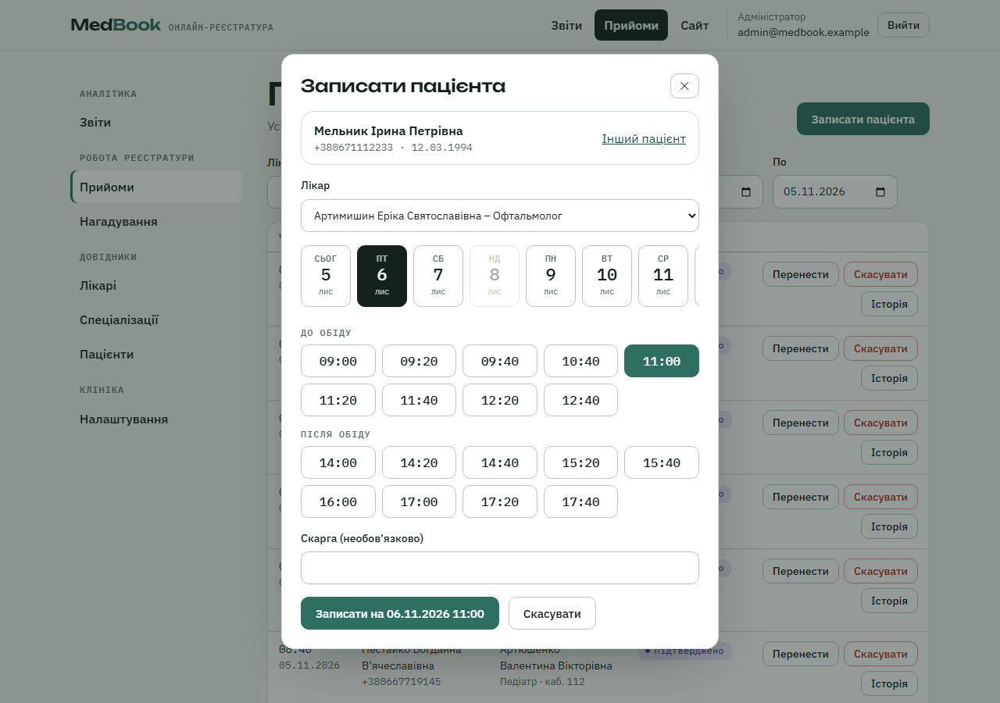
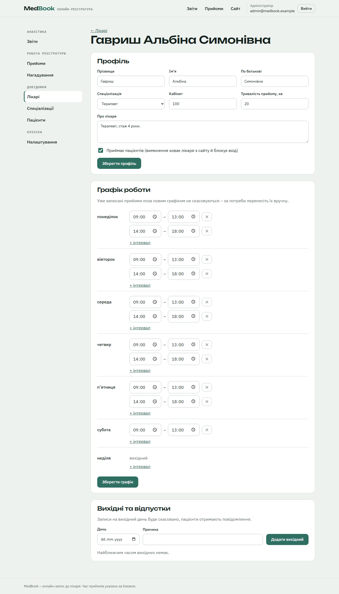

# MedBook

Online doctor appointment system. Patients find a doctor by specialization, pick a
free time slot and get e-mail and SMS reminders. Doctors work through their weekly
schedule and close visits with notes. Administrators manage staff, schedules, days
off, patients and clinic settings, and see reports.

Coursework for *Software Documentation and Design Patterns* (Lviv Polytechnic), project 9.
The design is built around eleven GoF patterns that cooperate in the same flows –
see [Design patterns](#design-patterns).



## Contents

- [Features](#features)
- [Quick start with Docker](#quick-start-with-docker)
- [Demo accounts](#demo-accounts)
- [Real e-mail and SMS](#real-e-mail-and-sms)
- [Local development](#local-development)
- [Tests and checks](#tests-and-checks)
- [Architecture](#architecture)
- [Design patterns](#design-patterns)
- [Project structure](#project-structure)
- [Diagrams](#diagrams)
- [Screenshots](#screenshots)

## Features

**Patients and visitors**
- Browse specializations and doctors, each with the nearest free time
- Register (full name, phone, e-mail, date of birth) and sign in
- Book a visit on a 14-day calendar of free slots; the slot is held at once
- See upcoming and past visits with the doctor's notes and the status history
- Reschedule or cancel online up to a configurable cut-off before the visit
- Choose reminder channels: e-mail, SMS or both

**Doctors**
- Weekly schedule with patient age, phone and complaint
- Confirm a visit, complete it with notes, or mark a no-show (only once it started)
- History of past visits

**Administrators**
- Book a patient by phone, reschedule and cancel any visit
- Manage doctors (account and profile created together), specializations, patients
- Weekly working hours with breaks; days off – visits already booked on that day
  are cancelled and the patients are notified
- Clinic settings: reminder lead times, booking horizon, cancel cut-off, daily limit
- Notification log with manual retry of failed messages
- Reports with charts: visits per day / month / doctor, doctor workload,
  growth of new patients

**Reminders**
- Booking confirmation, e-mail reminder (24 h before) and SMS reminder (2 h before)
- Cancellation notice; reminders of a cancelled or moved visit are withdrawn
- Delivered by a separate worker from a transactional outbox, with retries

## Quick start with Docker

Requirements: Docker with Docker Compose v2.

```bash
git clone https://github.com/sergiyclas/medbook.git
cd medbook
cp .env.example .env        # optional – every value has a working default
docker compose up --build
```

On first start the backend applies the database migrations and fills the database
with demo data (10 doctors, ~400 patients, ~6 months of visit history).

| Service | URL |
|---|---|
| Web application | http://localhost:8080 |
| REST API and Swagger UI | http://localhost:8000/docs |
| PostgreSQL | `localhost:5433` (user / password / db: `medbook`) |
| Adminer (database browser, optional) | http://localhost:8081 – start with `docker compose --profile tools up -d` |

Useful commands:

```bash
docker compose logs -f worker                          # watch reminders being sent
docker compose exec backend python -m app.seed --force # recreate the demo data
docker compose down -v                                 # stop and delete the database
```

> PostgreSQL is published on host port **5433** so that it does not clash with a
> locally installed server on 5432. Change `POSTGRES_PORT` in `.env` if needed.

## Demo accounts

| Role | E-mail | Password |
|---|---|---|
| Patient | `patient@medbook.example` | `patient123` |
| Doctor | `doctor@medbook.example` | `doctor123` |
| Administrator | `admin@medbook.example` | `admin123` |

The sign-in page lists them too – click one to fill the form. All seeded doctors
use the `doctor123` password (`doctor02@medbook.example` … `doctor10@…`).
Seeded patients have reminders switched off: their contact details are invented.

## Real e-mail and SMS

By default `NOTIFICATION_MODE=console`: the worker prints every message to its log
and nothing leaves the machine. To send real messages, set in `.env`:

```dotenv
NOTIFICATION_MODE=live

SMTP_HOST=smtp.gmail.com
SMTP_PORT=587
SMTP_USERNAME=you@gmail.com
SMTP_PASSWORD=xxxx xxxx xxxx xxxx     # Gmail App Password, not your account password
MAIL_FROM=MedBook <you@gmail.com>

TWILIO_ACCOUNT_SID=ACxxxxxxxxxxxxxxxxxxxxxxxxxxxxxxxx
TWILIO_AUTH_TOKEN=xxxxxxxxxxxxxxxxxxxxxxxxxxxxxxxx
TWILIO_FROM_NUMBER=+1xxxxxxxxxx
```

then `docker compose up -d --build backend worker`.

- **Gmail:** turn on 2-Step Verification for the account, then create an App Password
  at <https://myaccount.google.com/apppasswords>.
- **Twilio:** a trial account sends SMS only to phone numbers verified in the console
  and prefixes messages with a trial notice. For Ukrainian numbers, allow Ukraine under
  *Messaging → Settings → Geo permissions*.
- Live mode refuses to start unless **both** channels are configured, so a
  half-configured setup is never mistaken for a working one.
- To try it, register yourself as a patient with your own e-mail and phone and book a visit.

## Local development

Backend (Python 3.13, [uv](https://docs.astral.sh/uv/)):

```bash
docker compose up -d db                 # only the database
cd backend
uv sync
uv run alembic upgrade head
uv run python -m app.seed
uv run uvicorn app.main:app --reload    # http://localhost:8000/docs
uv run python -m app.worker             # reminders, in a second terminal
```

Frontend (Node 22):

```bash
cd frontend
npm install
npm run dev                             # http://localhost:5173, proxies /api to :8000
```

Configuration is read from `.env` in the repository root (see `.env.example`);
`backend/app/core/config.py` lists every setting with its default.

## Tests and checks

```bash
cd backend
uv run pytest          # 116 tests: domain, rules, events, notifications, reports, API
uv run ruff check . && uv run ruff format --check .

cd ../frontend
npm run lint && npm run build      # oxlint, strict TypeScript, production bundle
```

The backend tests run on an in-memory SQLite database. GitHub Actions runs the same
checks for both parts on every push.

## Architecture

```
React SPA ──HTTP/JSON──▶ FastAPI routers ──▶ services ──▶ domain ──▶ repositories ──▶ PostgreSQL
 (nginx)                 (thin, /api/v1)     (use cases)   (state,     (SQLAlchemy
                                                            rules)      session = unit of work)
                                                │
                                   domain events (Observer)
                                                ▼
                              notifications table (transactional outbox)
                                                │  polled every 15 s
                                                ▼
                                worker ──▶ SMTP (Gmail) / Twilio
```

- **Layered architecture.** Routers only translate HTTP; use cases live in services;
  business rules in the domain; SQL in repositories.
- **CQRS-lite.** Commands (book, cancel, reschedule) go through the booking facade,
  the rule chain and the state machine; reports are a separate read side.
- **Transactional outbox.** Event handlers only add `notifications` rows in the same
  transaction as the booking, so a failing mail server can never roll back a visit;
  the worker delivers them later.
- **Time.** Timestamps are stored in UTC; working hours are local wall-clock times
  of the clinic (`Europe/Kyiv`), so a DST switch moves the UTC offset, not the visit.
- **Double booking** is prevented twice: by the `SlotFree` rule and by a partial
  unique index on `(doctor_id, starts_at)` for active visits, which catches a race.

## Design patterns

Each GoF pattern is used where the domain asks for it; colours match the class diagrams.

| Pattern | Where | Why here |
|---|---|---|
| **Singleton** | [`core/config.py`](backend/app/core/config.py) `get_settings()`, [`notifications/factory.py`](backend/app/notifications/factory.py) `get_transport_factory()` | One configuration and one transport family per process |
| **Abstract Factory** | [`notifications/factory.py`](backend/app/notifications/factory.py) `TransportFactory` → `ConsoleTransportFactory`, `LiveTransportFactory` | E-mail and SMS senders come as a matching family; each `create_*` is a factory method |
| **Builder** | [`notifications/messages.py`](backend/app/notifications/messages.py) `MessageComposer` (director), `EmailMessageBuilder`, `SmsMessageBuilder` | The same steps produce an HTML e-mail or a 134-character SMS |
| **Adapter** | [`notifications/adapters.py`](backend/app/notifications/adapters.py) `SmtpEmailAdapter`, `TwilioSmsAdapter` | `smtplib` and the Twilio SDK behind one `Sender` interface, errors mapped to `DeliveryError` |
| **Decorator** | [`notifications/decorators.py`](backend/app/notifications/decorators.py) `LoggingSender(RetryingSender(adapter))` | Logging and quick retries added without touching the adapters |
| **Facade** | [`services/booking_facade.py`](backend/app/services/booking_facade.py) `BookingFacade` | One entry point for every appointment use case; owns the single commit |
| **Observer** | [`services/event_bus.py`](backend/app/services/event_bus.py), [`services/event_handlers.py`](backend/app/services/event_handlers.py) | A booking triggers history, reminders and withdrawals without the facade knowing who listens |
| **State** | [`domain/appointment_state.py`](backend/app/domain/appointment_state.py) | Each status decides what is allowed: patients cancel only before the cut-off, visits complete only after they start |
| **Strategy** | [`services/reports/grouping.py`](backend/app/services/reports/grouping.py) `GroupByDay`, `GroupByMonth`, `GroupByDoctor` | "Per day / month / doctor" from the assignment, interchangeable for every report |
| **Template Method** | [`services/reports/base.py`](backend/app/services/reports/base.py) `BaseReport.generate()` | Fixed collect → group → post-process → present; reports override what they measure |
| **Chain of Responsibility** | [`services/booking_rules.py`](backend/app/services/booking_rules.py) | Nine booking rules; patients and reception get different chains from the same handlers |

Also used: Repository and Unit of Work (PoEAA), GRASP (Information Expert –
`AvailabilityCalendar`, Creator – `ReminderScheduler`, Controller – `BookingFacade`,
Pure Fabrication, Protected Variations) and SOLID (new rules, reports and groupings
are added without editing existing classes).

## Project structure

```
backend/
  app/
    api/v1/          REST routers: auth, catalog, appointments, doctor cabinet, admin, reports
    core/            settings (Singleton), security (JWT, bcrypt), clinic time
    domain/          enums, State machine, domain events, errors, slot maths
    models/          SQLAlchemy entities
    repositories/    Repository classes over the session
    services/        BookingFacade, booking rules (CoR), event bus (Observer), admin, reports
    notifications/   ports, adapters, decorators, factory, message builders, dispatcher
    bootstrap.py     composition root: event bus and dispatcher wiring
    worker.py        notification worker
    seed.py          demo data
  alembic/           migrations
  tests/
frontend/
  src/api            typed REST client
  src/components     talon, slot picker, dialogs
  src/pages          public, patient, doctor, admin
docs/
  diagrams/          PlantUML sources and rendered PNGs
  screenshots/       screenshots and the script that captures them
docker-compose.yml
```

## Diagrams

PlantUML sources are in [`docs/diagrams`](docs/diagrams); all class diagrams are
views of one model file, so they stay consistent. Rendered images are committed.

```bash
PLANTUML_JAR=/path/to/plantuml.jar sh docs/diagrams/render.sh   # needs Java and Graphviz
```

The script first checks that every class on the diagrams exists in the code.

| Diagram | |
|---|---|
| Use cases | [patients](docs/diagrams/out/use-cases.png) · [staff](docs/diagrams/out/use-cases-staff.png) |
| Classes | [whole system](docs/diagrams/out/classes-overview.png) · [booking](docs/diagrams/out/classes-booking.png) · [notifications](docs/diagrams/out/classes-notifications.png) · [reports](docs/diagrams/out/classes-reports.png) |
| Behaviour | [booking sequence](docs/diagrams/out/sequence-booking.png) · [reminder sequence](docs/diagrams/out/sequence-reminder.png) · [appointment states](docs/diagrams/out/appointment-states.png) |
| Data and runtime | [database schema](docs/diagrams/out/er-diagram.png) · [deployment](docs/diagrams/out/deployment.png) |



## Screenshots

| | |
|---|---|
|  |  |
|  |  |
|  |  |
|  |  |

All screenshots: [`docs/screenshots`](docs/screenshots). Recapture them with
`python docs/screenshots/capture.py` (instructions inside the script).
